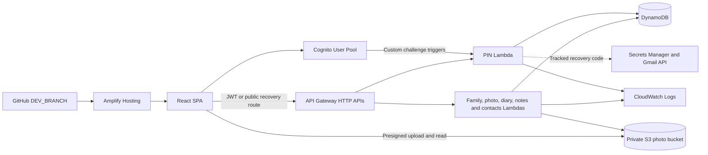

# System architecture

Last verified: 2026-11-22.

The browser renders the React SPA and uses Cognito for identity. API Gateway validates JWTs for protected routes. Python handlers perform validation and owner-scoped DynamoDB operations. Profile photos use short-lived presigned S3 access.

## System boundaries

- Browser code sends business fields and renders response state. The protected handlers use the Cognito identity provided by Gateway to select the owner.
- Cognito email verification and application PIN recovery are separate mechanisms. See [authentication](10-AUTHENTICATION-SECURITY.md).
- Frontend and Lambda releases are separate workflows. [Deployment](11-DEPLOYMENT-GUIDE.md) describes the verified frontend build and documented backend packaging.
- The diagram shows the development environment. Needs verification: production topology, custom domains, and environment separation.

Sources: [React entry point](../src/main.jsx), [backend mapping](../backend/README.md), [AWS inventory](07-AWS-INFRASTRUCTURE.md), [API contracts](08-API-CONTRACTS.md), and [data model](09-DATABASE-SCHEMA.md).
