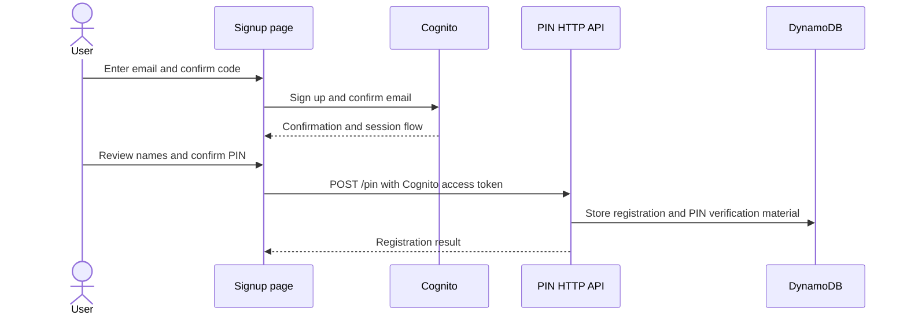
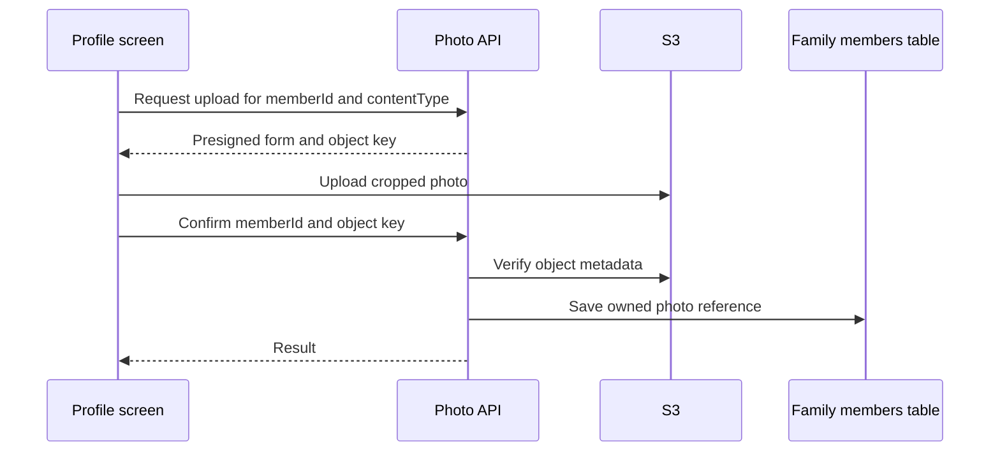

# User journeys

Last verified: 2026-11-22. These are source traces. See [testing](12-TESTING-CHECKLIST.md) for evidence still needed.

## Signup and PIN creation

From [SignupPage.jsx](../src/auth/SignupPage.jsx), enter email, verify the six-digit Cognito code, enter your name and family name, review, then enter and confirm a four-digit PIN. Signup obtains a Cognito session before saving the PIN. The dashboard subsequently loads the registered profile.

## Sign-in and recovery

[LoginPage.jsx](../src/auth/LoginPage.jsx) resolves the email identity, starts a Cognito custom challenge and submits the PIN. [ForgotPinPage.jsx](../src/auth/ForgotPinPage.jsx) requests a recovery code, verifies it and submits the new PIN with the reset authorization. See [auth](10-AUTHENTICATION-SECURITY.md) for session and recovery rules.

## Family and photos

The registered account owner is distinct from additional members. The initial family contains the owner alone. The dashboard places the owner first and loads additional members through the authenticated Family Members API. Additional members use unique `memberId` values. The self photo uses `PROFILE#SELF`. See [family rules](05-FEATURE-SPECIFICATIONS.md#family-ownership-and-filtering).

The local frontend previews up to four profiles, including the owner, in a horizontally scrollable row with Add Member at the end. Select **View All** to open the full family directory, or select **Add Member** to start a new profile. Enter the required fields first. On the final review step, choose and crop an optional profile photo, then select Add Member. The app creates the member before uploading the photo. You can also save without a photo and add one later. Open My Profile for the signed-in user's profile.

## Records and navigation

Open Diary, Notes, or Important Contacts from the dashboard or linked category, then list, create, view, edit, or delete records where supported. Category search filters card titles. The selector starts with **All Family** and **Me** and adds relationship options from the authenticated member list. Selection updates the UI. Filtering stored records by `memberId` is future work. Events currently provides calendar navigation and a visual empty state.

Sources: [dashboard](../src/MyFamilyPage.jsx), [member form](../src/AddFamilyMemberPage.jsx), [photo wrapper](../src/api/profilePicturesApi.js), and [feature specs](05-FEATURE-SPECIFICATIONS.md).
